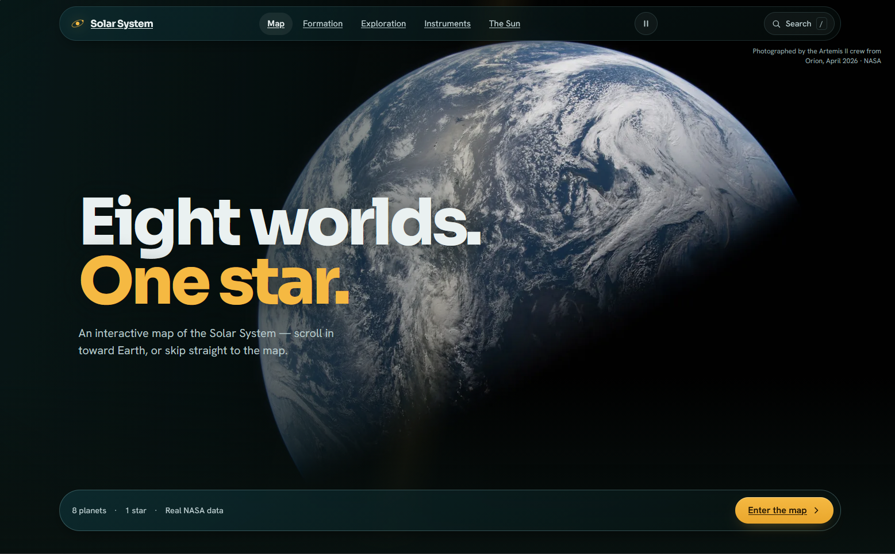
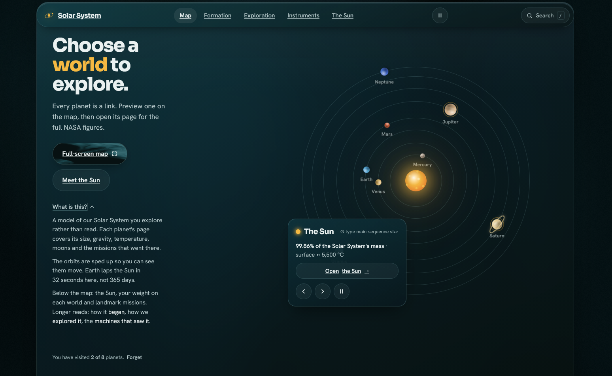
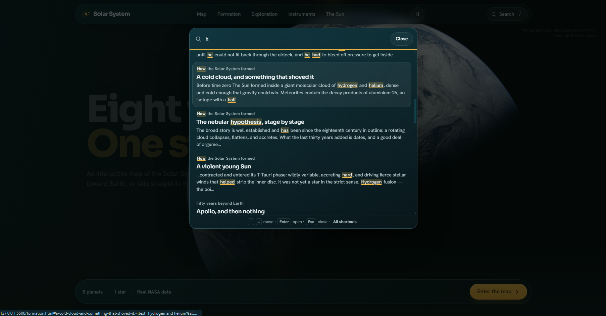
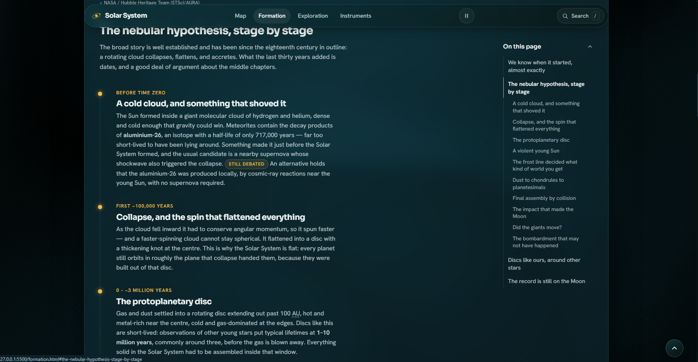
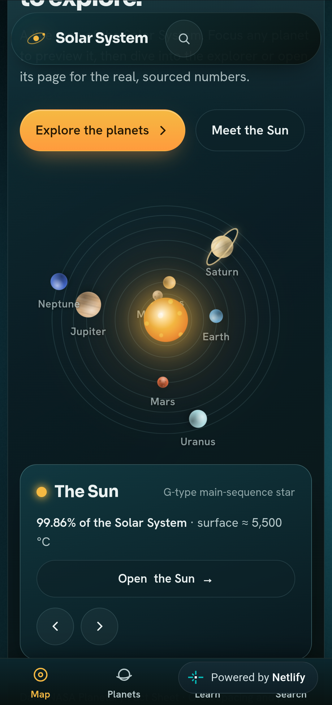

🌌 Solar System Exploration

Explore the planets. Discover the missions. Look beyond Earth.

An interactive astronomy website for discovering the planets, exploring space missions, and learning how humanity studies our cosmic neighborhood.

  <a href="https://tigerkossk.github.io/Solar-System-Exploration/"><strong>🚀 Open the Website</strong></a>
  &nbsp; · &nbsp;
  <a href="https://github.com/Tigerkossk/Solar-System-Exploration"><strong>📦 View the Repository</strong></a>

  
  
  

✨ Explore the experience

Solar System Exploration brings visual exploration and educational content together in one place. Move between planets, customize the orbit view, discover scientific missions, and navigate information with tools designed to make learning about space feel clear and engaging.

🖼️ A closer look

Select any screenshot to view it at full size.

<table>
  <tr>
    <td width="50%" align="center">
      
      <strong>01 · Main menu</strong> 
      A starting point for exploring the website.
    </td>
    <td width="50%" align="center">
      
      <strong>02 · Solar System view</strong> 
      Explore the planetary layout and available orbit styles.
    </td>
  </tr>
  <tr>
    <td width="50%" align="center">
      
      <strong>03 · Search</strong> 
      Find available information across the website.
    </td>
    <td width="50%" align="center">
      
      <strong>04 · Missions & discoveries</strong> 
      Connect scientific discoveries with space exploration.
    </td>
  </tr>
</table>

  
<strong>📱 Mobile preview</strong> <em>— older interface</em>

  
<em>This image shows an older version of the mobile interface; it does not represent the latest design.</em>

  

    
  

🚀 What you can do

<table>
  <tr>
    <td width="50%" valign="top">
      <h3>🪐 Explore planets</h3>
      Browse planet information, move between planets, and use visited marks to keep track of the worlds you've explored.
    </td>
    <td width="50%" valign="top">
      <h3>🔭 Customize the orbit view</h3>
      Switch between available orbit-view styles to explore the Solar System your way.
    </td>
  </tr>
  <tr>
    <td width="50%" valign="top">
      <h3>🛰️ Discover missions</h3>
      Learn about scientific instruments, exploration milestones, and discoveries that have expanded our understanding of space.
    </td>
    <td width="50%" valign="top">
      <h3>📚 Navigate articles</h3>
      Use the <strong>On this page</strong> contents list in supported articles to jump straight to a topic.
    </td>
  </tr>
  <tr>
    <td width="50%" valign="top">
      <h3>🧮 Use learning tools</h3>
      Convert kilograms ↔ pounds in the calculator and look up astronomy terms in the glossary.
    </td>
    <td width="50%" valign="top">
      <h3>🔗 Share what you find</h3>
      Use Share buttons or copy a direct link to a specific section for easy reference.
    </td>
  </tr>
</table>

⌨️ Navigation shortcuts

Shortcut

Action

←

Navigate to the previous planet.

→

Navigate to the next planet.

?

Open the keyboard-shortcut list.

Shortcuts may be unavailable while a text field or another interactive control has focus.

📖 Learning content

Explore educational information about:

☀️ The Sun and the planets

🌌 Solar System formation

🔭 Scientific instruments and the technologies used to study space

🚀 Missions, exploration milestones, and discoveries

🧰 Small tools, useful details

Search: find available information across the website.

Calculator: includes kilogram-to-pound and pound-to-kilogram conversion (kg ↔ lb).

Astronomy glossary: look up terms and concepts.

Article contents: jump to headings using On this page where available.

Section links: copy a direct link to a particular section.

Share buttons: share useful pages and information.

Pause motion: reduce animation while browsing.

♿ Accessibility & reading comfort

Accessibility and comfortable reading are part of the experience. The project includes:

Color-contrast improvements targeting WCAG AA contrast levels.

Support for Windows contrast themes.

Consideration for reduced-motion and reduced-transparency preferences.

A Pause motion control.

Print support for suitable pages and articles.

🎯 Project goal

Solar System Exploration aims to make astronomy easier to approach by combining visual exploration, focused educational content, and convenient navigation. It connects the worlds we study with the missions and technologies that help us understand them.

We've learned a great deal about our Solar System—but there is still much left to discover.

🌠 Explore. Discover. Learn. Look beyond Earth.

Open Solar System Exploration →

Solar System Exploration · Discover the worlds around us.

